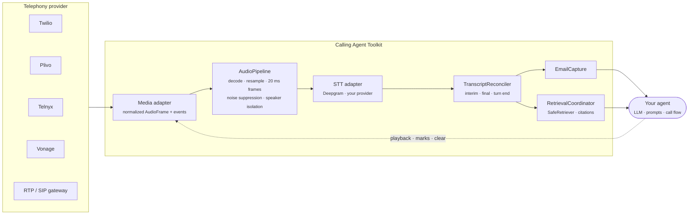
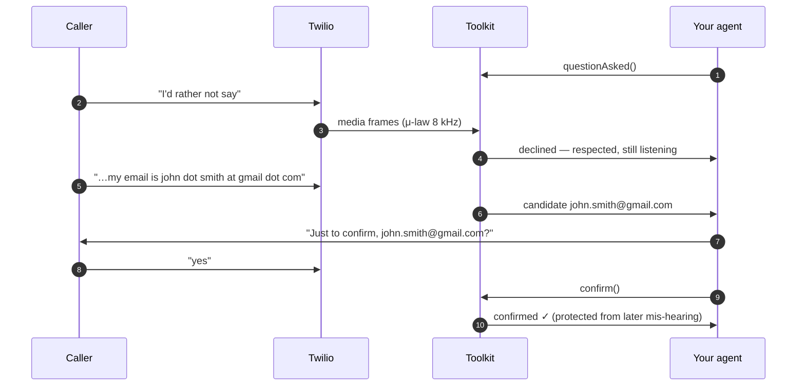
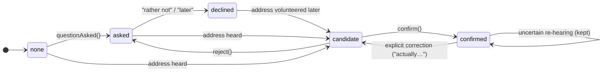

<p align="center">
  
</p>

<p align="center">
  <a href="https://github.com/vasikmansuri/universal-calling-agent-toolkit/actions/workflows/ci.yml"></a>
  
  
  
  
  
  
</p>

<p align="center">
  <b>Plug reliable telephony, clean audio, email capture, speech-to-text and RAG into the AI calling agent you already have.</b><br/>
  Provider-neutral · TypeScript and Python · one shared contract · no lock-in
</p>

<p align="center">
  <a href="#-quick-start">Quick start</a> ·
  <a href="#-live-demo">Live demo</a> ·
  <a href="#-how-it-works">How it works</a> ·
  <a href="#-providers">Providers</a> ·
  <a href="#-documentation">Docs</a>
</p>

---

## Why

Voice agents keep failing in two places:

1. **Email addresses get lost.** Callers skip the question, say it later, or spell it out. Partial STT fragments get glued together, and a later mis-hearing overwrites a good address.
2. **Audio quality is guesswork.** Noise suppression is "on" but STT hears the raw stream, codecs get converted three times, and every telephony provider speaks a different protocol.

This toolkit fixes both **without replacing your stack**. Your LLM, prompts and call flow stay yours. You get small, tested components that sit between your telephony provider and your agent.

## ✨ Features

| | |
|---|---|
| 📞 **Any telephony provider** | Twilio, Plivo, Telnyx and Vonage adapters, plus generic JSON WebSocket, raw PCM, RTP (SIP gateways / Asterisk) and WAV batch input. Call control and media transport are separate, and every capability is declared explicitly |
| 🎧 **One audio pipeline** | G.711 decode, streaming resampler, 20 ms framing and a pluggable noise-suppression / speaker-isolation chain. STT receives *exactly* the processed audio. Status is honest: suppression is never reported active when it isn't |
| ✉️ **Email capture that doesn't guess** | Understands "john dot smith at gmail dot com", spelled letters and "s as in sam". It respects refusals, accepts the address later, asks for clarification instead of inventing characters, and protects a confirmed address |
| 📝 **STT reconciliation** | Turns interim, final and turn-end results into clean, de-duplicated transcript events. Includes a Deepgram live adapter |
| 📚 **Safe RAG** | Tenant and ACL enforcement, timeouts, cancellation, stale-result protection, citations, and retrieved text marked as untrusted. Works with LangChain and LlamaIndex |
| 🔐 **Secure by default** | Webhook and stream signature validation (checked against the official Twilio and Plivo SDKs), bounded buffers, no payload logging, secrets resolved on use |
| 🧪 **Two languages, one contract** | JSON Schema contracts and shared fixtures, so TypeScript and Python behave identically |

## 🎬 Live demo

A real-time dashboard drives a simulated call through the **actual toolkit code**: Twilio wire messages → adapter → audio pipeline → transcript reconciler → email capture and RAG.

<p align="center">
  
</p>

```sh
cd packages/typescript && npm ci && npm run build && cd ../..
node examples/live-dashboard/server.mjs      # open http://localhost:4173
```

> Caller audio is synthesized and the caller's speech-to-text results are scripted, so the demo needs no provider account or API key. Everything after STT is the real library.

## 🧭 How it works



Each box is independent: use the email capture alone, or the adapters alone. The toolkit never opens servers or picks your LLM.

### A call, step by step



### Email capture states



## 🚀 Quick start

> Not on npm or PyPI yet. Install from this repository until the first release.

### TypeScript

```ts
import { AudioPipeline, EmailCapture, SttAudioBridge, TranscriptReconciler } from "@vasikmansuri/calling-agent-toolkit";
import { TwilioMediaTransport } from "@vasikmansuri/calling-agent-toolkit/twilio";

// 1. Wrap the WebSocket you already have.
const session = new TwilioMediaTransport({ authToken: () => secrets.get("TWILIO_AUTH_TOKEN") })
  .createSession({ sendText: async (d) => ws.send(d), close: async () => ws.close() }, { bidirectional: true });
ws.on("message", (data) => session.receive(data.toString()));

// 2. One pipeline feeds STT exactly what it processed.
const pipeline = new AudioPipeline({ targetSampleRate: 16000 });
const bridge = new SttAudioBridge(pipeline, sttSession, pipeline.targetFormat);
for await (const event of session.events()) {
  if (event.type === "audio") await bridge.push(event.frame);
}

// 3. Transcript events drive email capture.
const reconciler = new TranscriptReconciler({ tenantId: "acme", sessionId: callSid });
const email = new EmailCapture();
for await (const result of sttSession.results()) {
  for (const event of reconciler.accept(result)) {
    for (const r of await email.handle(event)) {
      if (r.type === "candidate") agent.say(`Just to confirm, ${r.email}?`);
    }
  }
}
```

### Python

```python
from calling_agent_toolkit.email_capture import EmailCapture, TranscriptEvent

capture = EmailCapture()
await capture.question_asked("acme", "call-1")

event = TranscriptEvent("e1", "acme", "call-1", "turn-1", "final", "my email is john dot smith at gmail dot com")
print(await capture.handle(event))
# [{'type': 'candidate', 'email': 'john.smith@gmail.com', 'literal': False, 'turnId': 'turn-1', 'replacesConfirmed': False}]
```

More: [`examples/`](examples) holds end-to-end scripts in both languages.

## 🔌 Providers

| Provider | Live audio | Playback / marks / clear | Call control | Signatures | Status |
|---|:---:|:---:|:---:|:---:|---|
| **Twilio** | ✅ | ✅ | ✅ calls, hangup, transfer, streams | ✅ webhook + stream | fixture-tested |
| **Plivo** | ✅ | ✅ | ✅ calls, hangup, transfer, DTMF, streams + native noise cancellation | ✅ V3 | fixture-tested |
| **Telnyx** | ✅ | ✅ | — | host hook | fixture-tested |
| **Vonage** | ✅ | ✅ | — | ✅ JWT / custom | fixture-tested |
| **RTP / SIP / Asterisk** | ✅ | ✅ packetized | your PBX | your PBX | packet-level tested |
| **Generic JSON WebSocket** | ✅ | receive-only | — | host hook | tested |
| **WAV / recordings** | batch only | — | — | — | tested |

"Fixture-tested" means tested against protocol messages from official docs (and signatures generated by the official SDKs), **not yet against live accounts**. Known gaps and open questions are listed in [PROVIDER_COMPATIBILITY.md](docs/PROVIDER_COMPATIBILITY.md).

**STT:** Deepgram live (fixture-tested). Other providers can plug into the `StreamingSttAdapter` interface.
**RAG:** any backend via `Retriever`; LangChain is tested against real `langchain-core`.

## ⚡ Performance

Single-threaded micro-benchmarks, Apple M4 ([how to reproduce](docs/TESTING.md#benchmarks)):

| Per 20 ms audio frame | TypeScript | Python |
|---|---:|---:|
| Full pipeline (decode + resample 8→16 kHz + framing) | **7.9 µs** | 85 µs |
| Twilio media message → normalized frame | 3.4 µs | 7.3 µs |
| Email extraction per utterance | 0.9 µs | 3.9 µs |

A frame arrives every 20,000 µs, so processing uses well under 1% of real time per stream. Noise-suppression engines, network and STT are not included.

## 🗂 Project layout

```
contracts/           JSON Schema + shared fixtures — the single source of truth
packages/typescript  @vasikmansuri/calling-agent-toolkit   (. /twilio /plivo /telnyx /vonage /deepgram)
packages/python      calling-agent-toolkit                 (calling_agent_toolkit.providers.*)
examples/            live dashboard + end-to-end scripts
benchmarks/          reproducible micro-benchmarks
docs/                architecture, providers, audio, email, STT, RAG, security, testing, release
```

## 📖 Documentation

| Guide | |
|---|---|
| [Architecture](docs/ARCHITECTURE.md) | Contracts, adapters, capability negotiation |
| [Provider compatibility](docs/PROVIDER_COMPATIBILITY.md) | What works, what doesn't, what's unverified |
| [Adapter development](docs/ADAPTER_DEVELOPMENT.md) | Add a provider + run the conformance suite |
| [Audio pipeline](docs/AUDIO_PIPELINE.md) | Resampling, processors, engine evaluation |
| [Email capture](docs/EMAIL_CAPTURE.md) | Behaviour and limits |
| [STT integration](docs/STT_INTEGRATION.md) | Reconciler and Deepgram |
| [RAG integration](docs/RAG_INTEGRATION.md) | Access control, stale results, citations |
| [Security](docs/SECURITY.md) | Signatures, credentials, input limits |
| [Testing & benchmarks](docs/TESTING.md) | Fixtures, results, numbers |
| [Release checklist](docs/RELEASE_CHECKLIST.md) | What's left before 0.1.0 |

## 🛣 Roadmap

- [x] Twilio, Plivo, Telnyx and Vonage adapters · RTP · generic WebSocket · WAV batch
- [x] Audio pipeline, email capture, STT reconciler, safe RAG
- [ ] Bundled noise-suppression engine (RNNoise / DTLN), measured on real call audio
- [ ] Live-account integration tests for every provider
- [ ] More STT adapters (OpenAI, Google, Azure, AWS, ElevenLabs)
- [ ] Telnyx and Vonage call control · SignalWire
- [ ] `0.1.0` on npm and PyPI

## 🤝 Contributing

Contributions are welcome, especially new providers and noise-suppression engines. Read [CONTRIBUTING.md](CONTRIBUTING.md); every change lands in both languages with shared fixtures.

If this project helps you, please ⭐ star the repo. It helps others find it.

## Author

Created and maintained by **[Vasik Mansuri](https://github.com/vasikmansuri)**.

If you use this project, keep the [NOTICE](NOTICE) file and the copyright headers, as the Apache-2.0 license requires, and a link back here is appreciated.

## License

Copyright 2026 Vasik Mansuri. Licensed under the [Apache License, Version 2.0](LICENSE). See [NOTICE](NOTICE).

## Support

If this project is useful to you, you can support my open-source work:

<a href="https://buymeacoffee.com/vasikmansuri"></a>
